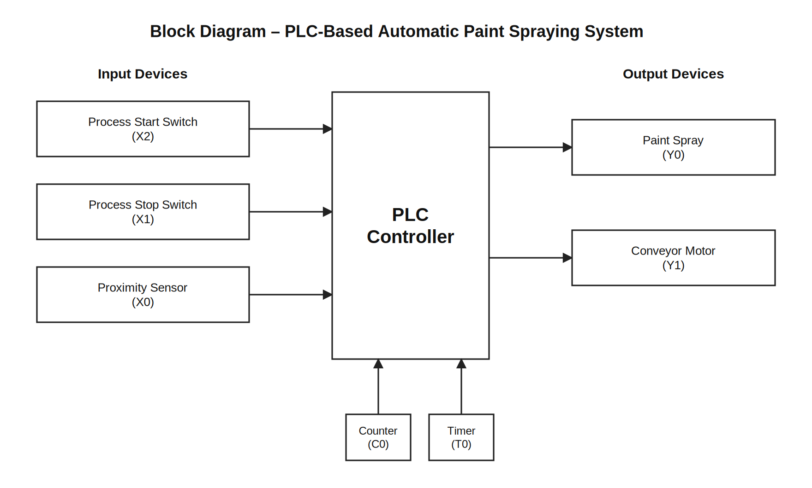
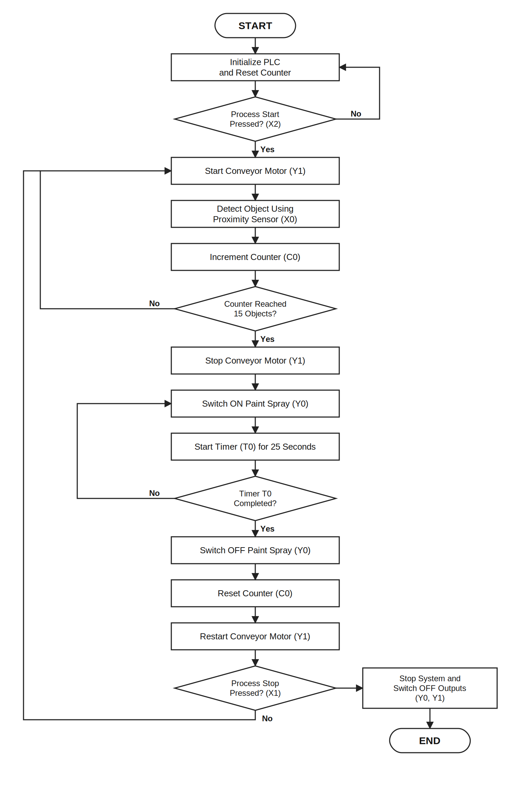
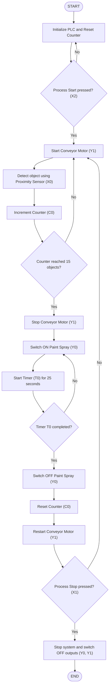
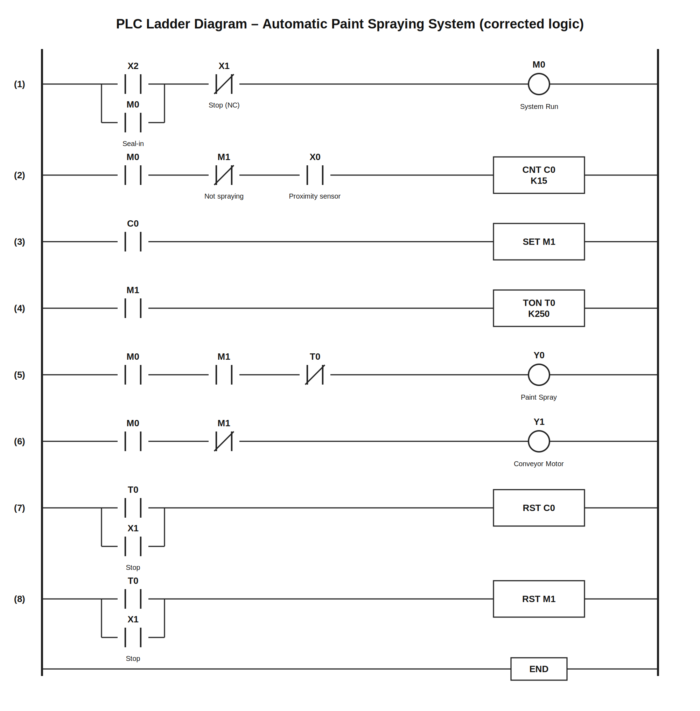
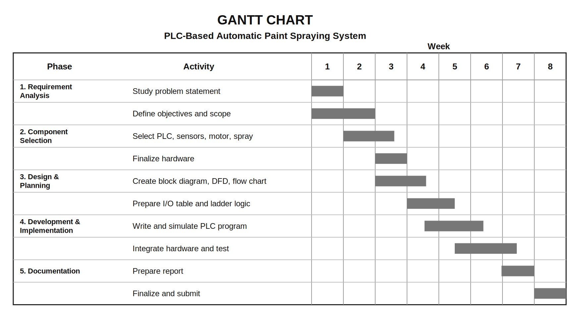

# PLC-Based Automatic Paint Spraying System

Third-year B.Tech capstone project (Electronics and Computer Science) built for the **Programmable Logic Controllers and SCADA** courses at St. John College of Engineering & Management, University of Mumbai (2025-2026).

A PLC counts objects on a conveyor using a proximity sensor. When **15 objects** are detected the conveyor stops, the paint spray runs for **25 seconds**, then the spray switches off and the conveyor restarts for the next batch. Start and Stop switches enable and disable the process.

## How it works

1. Press **Process Start (X2)**: the system turns on and the conveyor motor (Y1) runs.
2. The **proximity sensor (X0)** detects each object and counter **C0** counts up to 15.
3. At 15 objects the conveyor stops and the **paint spray (Y0)** turns on.
4. Timer **T0** runs for 25 seconds while the conveyor stays stopped.
5. After 25 s the spray turns off, the counter resets and the conveyor restarts.
6. **Process Stop (X1)** disables the system.

## PLC I/O assignment

| Address | Type | Function |
|---|---|---|
| X0 | Digital input | Proximity sensor (object detection) |
| X1 | Digital input | Process Stop switch (NC) |
| X2 | Digital input | Process Start switch (NO) |
| Y0 | Digital output | Paint spray |
| Y1 | Digital output | Conveyor motor |
| C0 | Counter | Counts 15 objects (K15) |
| T0 | Timer | 25 s spray duration (K250) |
| M0 | Internal relay | System run flag |
| M1 | Internal relay | 15 counted flag |

## Diagrams

Every diagram is available as an editable **SVG**, a **PNG**, and the **original image** taken from the report.

| Diagram | SVG / PNG | Original (from report) |
|---|---|---|
| Block diagram | [svg](diagrams/svg/block_diagram.svg) / [png](diagrams/svg/block_diagram.png) | [png](diagrams/original/block_diagram.png) |
| Flowchart | [svg](diagrams/svg/flowchart.svg) / [png](diagrams/svg/flowchart.png) | [png](diagrams/original/flowchart.png) |
| Ladder diagram (corrected) | [svg](diagrams/svg/ladder_diagram_corrected.svg) / [png](diagrams/svg/ladder_diagram_corrected.png) | |
| Ladder diagram (as in report) | [svg](diagrams/svg/ladder_diagram_report_version.svg) / [png](diagrams/svg/ladder_diagram_report_version.png) | [png](diagrams/original/ladder_diagram.png) |
| Gantt chart | [svg](diagrams/svg/gantt_chart.svg) / [png](diagrams/svg/gantt_chart.png) | [png](diagrams/original/gantt_chart.png) |

### Block diagram



### Flowchart



Mermaid version (rendered natively by GitHub):



### Ladder diagram



Text form of the same logic: [plc/ladder_logic.txt](plc/ladder_logic.txt).

### Gantt chart



## Simulation

The logic was programmed and simulated in Mitsubishi GX Works3 with GX Simulator3. Screenshots are in [docs/screenshots](docs/screenshots).

## Repository structure

```
.
├── README.md
├── LICENSE
├── diagrams/
│   ├── svg/        editable SVG + PNG exports
│   ├── original/   images extracted from the report
│   └── mermaid/    Mermaid sources (.mmd)
├── docs/
│   ├── Capstone_Project_Report.pdf
│   └── screenshots/
└── plc/
    └── ladder_logic.txt
```

## Future scope

HMI integration, adjustable batch size, paint-level monitoring, safety interlocks (emergency stop, safety-door switches), spray pressure/flow monitoring, data logging, and SCADA integration.

## Safety note

A real installation needs proper electrical protection, ventilation and equipment rated for the paint and environment. The Process Stop switch is not a substitute for an emergency-stop circuit.

## Team

- Atharva Patil (EU1247050)
- Kajal Rai (EU1247025)
- Sahel Biswas (EU1247002)
- Aarya Raut (EU1247058)

**Guide:** Mrs. Hiral Patel, Assistant Professor, Department of Electronics and Computer Science, SJCEM

## License

MIT, see [LICENSE](LICENSE).
